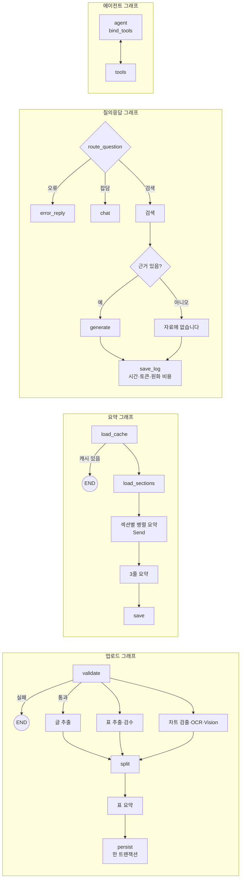

# HRI Insight Bridge

**경제 보고서 AI 요약·질의응답 및 관리자 모니터링 서비스**

경제 분석 보고서(PDF)를 올리면 **근거 쪽수와 함께 요약·답변**하고, 
여러 보고서의 경제 지표를 **한 표로 비교**해 주는 RAG 기반 웹 서비스입니다.

 

# HRI Insight Bridge — 경제 보고서 AI 요약·질의응답 챗봇

> **현대 AI 서비스 개발자 과정 1차 프로젝트 · 4조 InsightBridge**
> 현대경제연구원(HRI) 경제 분석 보고서를 올리면 3줄 요약, 섹션별 요약, 출처 쪽수가 붙은 답변을 주는 RAG 챗봇입니다.

| 기간 | 인원 | 내 역할 |
|---|---|---|
| 2026.10.19 ~ 11.02 (2주) | 6명 | **LangGraph 그래프 4종 설계·구현 전담** · **문서 처리 파이프라인(PDF·표·차트)** · 데이터 스키마 · 최종 발표 |

---

## 내 역할 한눈에 보기

> 서비스의 모든 흐름(업로드 → 요약 → 질의응답 → 도구 호출)이 지나가는 **LangGraph 그래프 4종을 혼자 설계하고 구현**했습니다.
> 팀원들의 서비스 코드가 모두 이 그래프를 import하기 때문에 **팀 일정의 선행 작업**이었고, 상태 정의와 뼈대를 먼저 머지해 팀원들이 동시에 개발할 수 있게 했습니다.

| 지표 | 수치 |
|---|---|
| 작성한 Pull Request | **25건** (머지 24건) |
| 머지된 코드 | **+7,267줄 / −673줄** |
| 커밋 | **84개** |
| 작성한 Issue | **25건** (모두 해결) |
| 리뷰한 PR | **9건** |
| 하루 최다 머지 | **8건** (10/27, LangGraph 집중 구현) |

---

## 기술 스택

| 분야 | 기술 |
|---|---|
| 언어 | Python 3.11 |
| LLM 오케스트레이션 | **LangGraph** (StateGraph, Send, 체크포인터, ToolNode), **LangChain** (bind_tools, with_structured_output, batch) |
| 문서 처리 | PyMuPDF, EasyOCR, OpenAI Vision |
| 데이터 | Pydantic v2, MySQL, Chroma |
| 테스트·협업 | pytest (fixture, monkeypatch, 변조 테스트), Poetry, Git/GitHub Flow |

---

## 1. LangGraph 그래프 아키텍처 (전담)

### 전체 구조

### 구현 내역

| 단계 | PR | 핵심 내용 |
|---|---|---|
| 그래프 상태 정의 | [#129](https://github.com/hyundai-insight-bridge/highlight-refresh-integrate/pull/129) | 그래프 4종의 State(TypedDict)와 RouteDecision(Pydantic). 병렬 노드 결과를 합치는 **리듀서**(`operator.add`, `add_messages`) 설계 |
| 그래프 뼈대·레지스트리 | [#140](https://github.com/hyundai-insight-bridge/highlight-refresh-integrate/pull/140) | 그래프 4종의 노드·엣지 뼈대, 체크포인터, 레지스트리(컴파일은 한 번만, 순환 import 방지). **팀원 작업의 선행 조건이라 가장 먼저 머지** |
| 질의응답 라우팅 | [#153](https://github.com/hyundai-insight-bridge/highlight-refresh-integrate/pull/153) | 오류 → 잡담 → 검색 → LLM 분류 순서로 판단. **잡담은 정규식으로 걸러 LLM을 부르지 않음** |
| 업로드 검증 노드 | [#167](https://github.com/hyundai-insight-bridge/highlight-refresh-integrate/pull/167) | 검증 실패 시 바로 종료. 다른 모듈의 docstring 오류와 임시값 버그도 함께 수정 |
| 요약 그래프 | [#176](https://github.com/hyundai-insight-bridge/highlight-refresh-integrate/pull/176) | `Send`로 섹션별 병렬 요약 후 쪽 순서로 정렬. **캐시가 있으면 LLM 호출 0회** |
| 에이전트 그래프 | [#181](https://github.com/hyundai-insight-bridge/highlight-refresh-integrate/pull/181) | Tool Calling 루프. 보고서 ID는 `InjectedState`로 주입해 **LLM이 임의로 바꿀 수 없게** 함 |
| 질의응답 답변 노드 | [#186](https://github.com/hyundai-insight-bridge/highlight-refresh-integrate/pull/186) | 답변·근거 없음·오류·잡담 노드, 질문마다 **응답 시간·토큰·원화 비용 기록** |
| 업로드 분할·저장 노드 | [#202](https://github.com/hyundai-insight-bridge/highlight-refresh-integrate/pull/202) | 섹션별 청크 분할, MySQL·Chroma 저장을 **한 트랜잭션으로 묶고 실패 시 rollback** |
| 업로드 추출 노드 | [#214](https://github.com/hyundai-insight-bridge/highlight-refresh-integrate/pull/214) | 글·표·차트 3갈래 병렬 추출. 차트 하나가 실패해도 업로드 전체는 계속 진행 |
| 안정화 | [#361](https://github.com/hyundai-insight-bridge/highlight-refresh-integrate/pull/361) | 질의응답 오류 시 멈추지 않고 로그를 남긴 뒤 일반 대화로 넘김 |

---

## 2. 문서 처리 파이프라인 (PDF → 글·표·차트 → RAG 데이터)

경제 보고서의 핵심 수치는 본문보다 **표와 차트**에 있습니다. 글만 읽는 챗봇과 다르게 표와 차트 이미지까지 검색할 수 있는 데이터로 바꿨습니다.

| 기능 | PR | 핵심 내용 |
|---|---|---|
| PDF 업로드 검증 | [#101](https://github.com/hyundai-insight-bridge/highlight-refresh-integrate/pull/101) | PDF가 아닌 파일, 30MB·150쪽 초과, 손상·암호화 파일을 입구에서 막고 이유를 안내 |
| 페이지별 추출·정제 | [#108](https://github.com/hyundai-insight-bridge/highlight-refresh-integrate/pull/108) | 매 쪽 반복되는 머리말·쪽 번호, 표지·목차를 지우고 본문만 남김 |
| 보고서 메타데이터 | [#233](https://github.com/hyundai-insight-bridge/highlight-refresh-integrate/pull/233), [#357](https://github.com/hyundai-insight-bridge/highlight-refresh-integrate/pull/357) | 출처 표시용 제목·발행기관 추출, 제목 오류 수정 |
| 표 변환·분할 | [#235](https://github.com/hyundai-insight-bridge/highlight-refresh-integrate/pull/235) | 표를 마크다운으로 변환하고 큰 표는 나눔 |
| 표 구조 검수 | [#244](https://github.com/hyundai-insight-bridge/highlight-refresh-integrate/pull/244) | 변환 후 구조가 유지됐는지 확인, 열 개수 안전장치 |
| 표 요약·저장 | [#254](https://github.com/hyundai-insight-bridge/highlight-refresh-integrate/pull/254) | 표마다 LLM 요약 → **검색은 요약으로, 답변은 원본 표로** |
| **차트 → 표 복원** | [#263](https://github.com/hyundai-insight-bridge/highlight-refresh-integrate/pull/263) | 차트 영역 검출 → EasyOCR → Vision 모델로 수치 복원 → **OCR 숫자와 대조해 신뢰도 계산**, 낮으면 "검토 필요" 표시 (+1,447줄) |

---

## 3. 데이터 스키마 설계

| PR | 내용 |
|---|---|
| [#41](https://github.com/hyundai-insight-bridge/highlight-refresh-integrate/pull/41), [#44](https://github.com/hyundai-insight-bridge/highlight-refresh-integrate/pull/44) | 외부 데이터 스키마 5종(Indicator, EcosChoice, EcosQuery, TermCard, ExchangeRate)과 테스트 |
| [#69](https://github.com/hyundai-insight-bridge/highlight-refresh-integrate/pull/69) | 보고서 스키마 10종(Page, Section, Chunk, Table, Report, ChartData 등)과 차트 실패 예외 |
| [#76](https://github.com/hyundai-insight-bridge/highlight-refresh-integrate/pull/76), [#93](https://github.com/hyundai-insight-bridge/highlight-refresh-integrate/pull/93) | 모듈 이름 불일치·문법 오류로 테스트가 돌지 않던 버그 수정 |

---

## 4. 문제 해결 — 감이 아니라 숫자로 판단

### 차트 오탐 337개 → 4개
- **문제**: 명세대로 큰 도형 영역을 차트로 잡았더니 HRI 보고서 37편에서 **337개 중 진짜 차트는 0개**였습니다(표, 글상자, 테두리).
- **해결**: 실제 데이터를 분석해 제외 규칙 4개를 만들었습니다(쪽 전체 영역, 그림을 감싼 상자, 표, 글자 비율이 높은 영역).
- **결과**: **337개 → 4개**로 줄었고, 다른 기관 보고서의 진짜 벡터 차트 11개는 하나도 놓치지 않았습니다.

### 표 47% 손실 방지
- **문제**: 검수에 걸린 표를 버리면 **표 294개 중 137개(약 47%)** 가 검색에서 사라졌습니다.
- **해결**: "버리지 말고 저장하되 경고를 남긴다"로 정책을 바꿨습니다.

### 그 밖의 설계 판단
| 문제 | 해결 |
|---|---|
| 도구를 여러 번 돌면 system 메시지가 쌓임 | 매 호출 앞에 붙이고 state에는 저장하지 않음 |
| MySQL과 Chroma에 나눠 저장하다 실패하면 반쪽 데이터가 남음 | 한 트랜잭션으로 묶고 실패하면 rollback + 벡터 삭제. 느린 LLM 요약은 트랜잭션 밖으로 빼 DB 잠금 시간 단축 |
| 근거가 없어도 LLM을 부르면 비용이 들고 지어낸 답이 나옴 | 근거가 없으면 LLM 없이 "자료에 없습니다"로 답함 |
| 출처에 보고서 이름이 잘못 나옴 | 메타데이터 제목을 먼저 쓰고 없으면 파일 이름 사용 |

---

## 5. 테스트와 검증

- **모든 기능 PR에 pytest를 함께 작성**했습니다. 그래프 테스트는 29개에서 111개로 늘렸습니다.
- **변조 테스트**: 코드를 일부러 망가뜨려 테스트가 잡아내는지 확인했습니다. 차트 모듈은 26가지 변조를 모두 잡아냈습니다([#263](https://github.com/hyundai-insight-bridge/highlight-refresh-integrate/pull/263)).
- **가짜 LLM·DB·Chroma**를 만들어 외부 서비스 없이 그래프 전체를 실행해 볼 수 있게 했습니다.
- **실데이터 점검**: HRI 보고서 37편 전체를 돌려 표 294개, 차트 875개를 검출하고, 잘라 낸 차트 이미지를 직접 열어 확인했습니다.

---

## 6. 협업

- **코딩 컨벤션 수립** ([#20](https://github.com/hyundai-insight-bridge/highlight-refresh-integrate/pull/20)): 팀 `CONTRIBUTING.md`에 이름 규칙과 코드 스타일 항목을 만들었습니다.
- **이슈 → 브랜치 → PR**: 모든 작업을 이슈로 먼저 만들고(25건) `feat/#이슈번호-이름` 브랜치에서 진행했습니다. PR마다 변경 사항, 변경 이유, 테스트 방법을 적었습니다.
- **코드 리뷰 9건**: 브랜치 전략, PR 템플릿, 프로젝트 구조 문서, DB 스키마, 의존성, ECOS API PR을 리뷰했습니다. 의존성 PR에서는 pytest 누락을 짚었습니다.
- **연결 지점 안내**: PR 본문에 팀원이 내 코드를 어떻게 불러야 하는지 적었습니다(예: [#181](https://github.com/hyundai-insight-bridge/highlight-refresh-integrate/pull/181)).
- **작업 순서 조정**: 팀원 코드가 의존하는 LangGraph를 먼저 구현하도록 순서를 바꾸고, 겹치던 ECOS API 작업은 설계 문서와 함께 다른 팀원에게 넘겼습니다.

## 7. 기획·설계·발표

- 현대경제연구원 공개 보고서 37편 수집과 양식 분석
- 외부 데이터 설계(ECOS 지표 코드 선정, 환율 출처 결정)
- 사용자 흐름도, 클래스 다이어그램, 시퀀스 다이어그램, 유스케이스 작성
- **최종 발표자** (2026.11.02)

---

## 작업 타임라인

| 날짜 | 작업 |
|---|---|
| 10/19 ~ 20 | 코딩 컨벤션 수립 |
| 10/26 | 외부 데이터·보고서 스키마, 버그 수정, PDF 검증·추출 |
| 10/27 | **LangGraph 그래프 4종 구현 (PR 8건 머지)** |
| 10/28 | 업로드 노드, 표 변환·검수·요약, 차트 검출·OCR·복원 (PR 7건 머지) |
| 10/30 | 통합 후 버그 수정(출처 이름, 질의응답 멈춤) |
| 11/02 | 최종 발표 |

---

## 팀 구성

| 이름 | 담당 |
|---|---|
| **엄정현 (본인)** | **LangGraph 그래프 4종, 문서 처리(PDF·표·차트), 데이터 스키마, 발표** |
| 류현수 | 팀장, 일정 관리 |
| 서동안 | RAG 질의응답 |
| 김희진 | 요약·페르소나 |
| 임세준 | MySQL·회원 |
| 장유빈 | Gradio UI·Tool Calling |

---

## 원본 레포지토리

이 레포는 팀 레포지토리를 포크한 것입니다.

- 원본: https://github.com/hyundai-insight-bridge/highlight-refresh-integrate
- 프로젝트 리뷰: https://www.figma.com/board/nT4HF6iunyN0C2H32luvA2/1%EC%B0%A8-%ED%94%84%EB%A1%9C%EC%A0%9D%ED%8A%B8_4%ED%8C%80?node-id=0-1&p=f&t=UGZpPxpc7ENiuuKn-0
